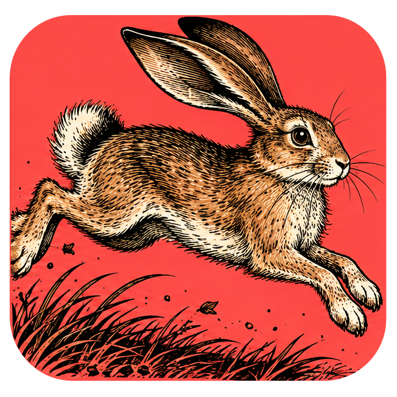
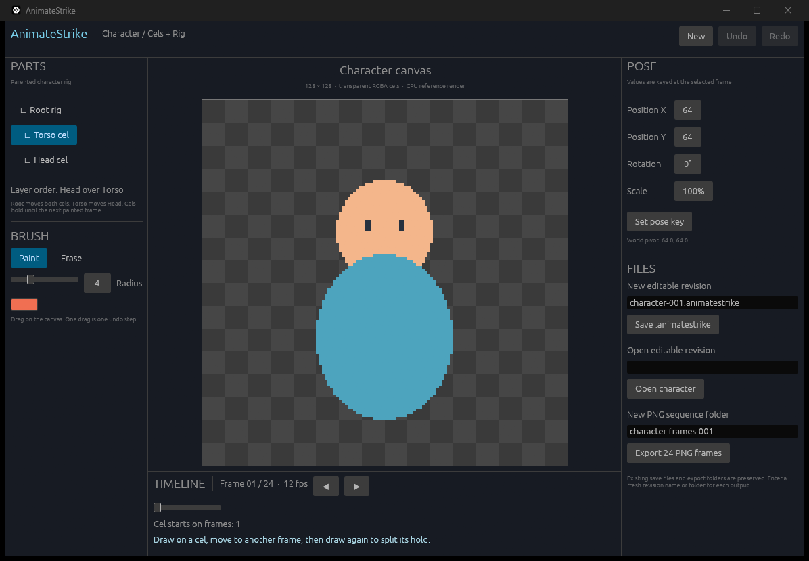

<p align="center">
  
</p>

<h1 align="center">AnimateStrike</h1>

<p align="center">
  <a href="https://prowebdevsolutions.com"><picture>
    <source media="(prefers-color-scheme: dark)" srcset="assets/branding/PWDS-logo-orange.svg">
    
  </picture></a>
</p>

<p align="center"><strong>Bring a small character to life.</strong></p>

AnimateStrike joins painted cels to a parented 2D rig. Set poses across a timeline, revise a short scene, keep editable project revisions, and export PNG frames.



*Native baseline preview from 12 October 2026, showing the original editor and its procedural three-part starter character. This is a source checkpoint image; the reduced standalone workspace on `main` has not been built or tested. See [screenshot provenance](docs/SCREENSHOT_PROVENANCE.md).*

<p align="center"><a href="#build-from-source">Build from source</a> · <a href="SOURCE_SCOPE.md">Source and test boundary</a> · <a href="apps/animatestrike/CONTROL.md">Control protocol</a> · <a href="assets/branding">Original artwork</a></p>

## Paint, pose, and export

### Work across cels and a rig

The current editor starts with a procedural **three-part, 128 × 128, 24-frame** character. Paint and erase on held cels, choose a rig part, then key its position, rotation, or scale at a frame. Scrub the timeline to inspect the resulting motion.

### Keep an editable revision

The app offers eight in-memory undo/redo steps. Saving creates a new immutable `.animatestrike` revision; it does not preserve an undo journal or autosave unsaved edits. A fresh revision path and same-directory hard-link support are required.

### Export the frames

Export writes a sequence of PNG frames, not an encoded movie. GIF export, timing/palette handling, a six-part release template, and persistent unsaved-work recovery remain open.

## Current status

This is a **source-only standalone candidate**, with no installer. The original checkout passed focused tests and a Windows loopback workflow; the reduced published workspace has resolved metadata but has **not** been compiled or tested as a standalone package. Native pointer, keyboard-only, screen-reader, high-DPI, broad import, and other-platform acceptance remain open.

## Build from source

From this repository root with Rust 1.95 or newer, the intended checks are:

```powershell
cargo test --locked -p strike-character --lib
cargo test --locked -p animatestrike --bin animatestrike
cargo build --locked -p animatestrike
```

These commands have not yet run against the reduced workspace. The selected EffectCraft crates, donor licenses and notices, synthetic fixtures, and seven embedded OFL fonts are included. No FilmCraft dependency is in this candidate's selected graph. [SOURCE_SCOPE.md](SOURCE_SCOPE.md) records exact provenance and the original test evidence.

The new AnimateStrike app and `strike-character` crate have no selected first-party license grant. The selected EffectCraft donor code keeps its original MIT/Apache texts and asset notices; this is not a redistributable binary package. Explore the other [PWDS Strike repositories](https://github.com/Gerbzz?tab=repositories&q=Strike).

## PWDS brand artwork

The company mark in this masthead is the existing [official PWDS logo](https://github.com/Gerbzz/PWDS-Website/blob/main/public/prowebdevsolutions-logo.png), with the [official orange display asset](https://prowebdevsolutions.com/images/prowebdevsolutions-logo-orange.svg) for dark backgrounds. Any app logo above it remains the original Strike suite artwork.
